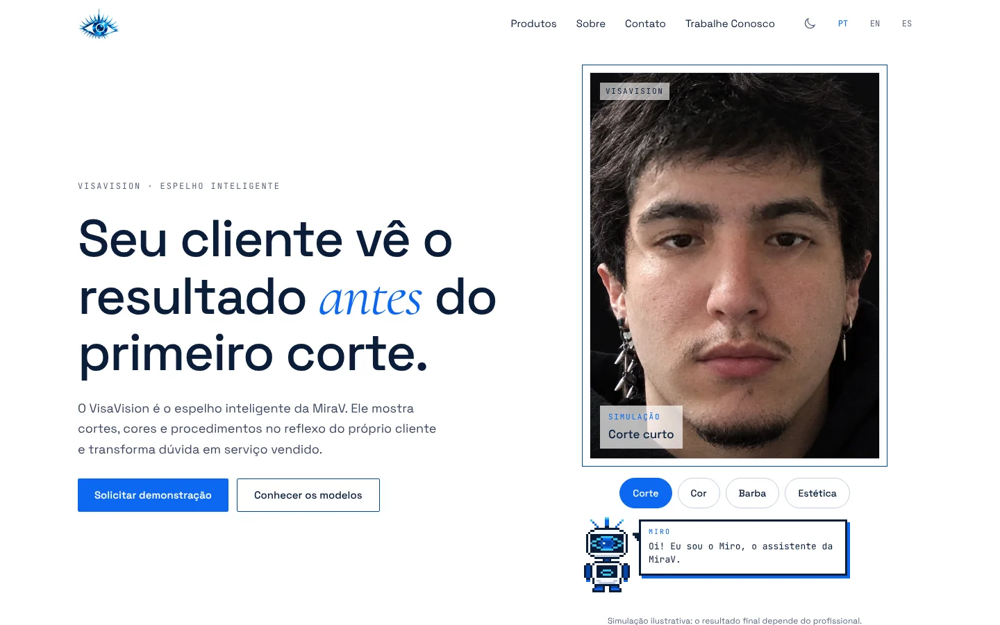
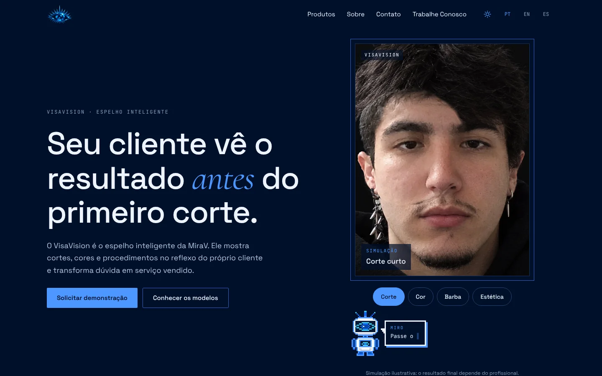
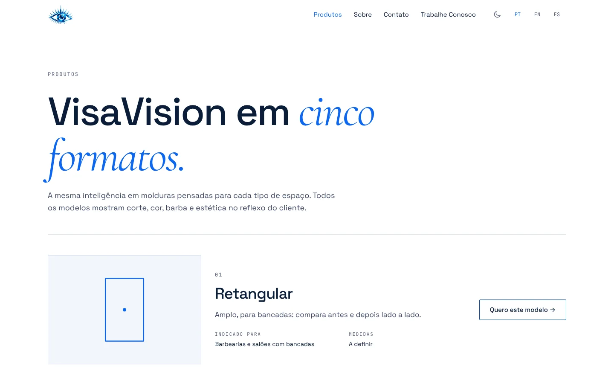
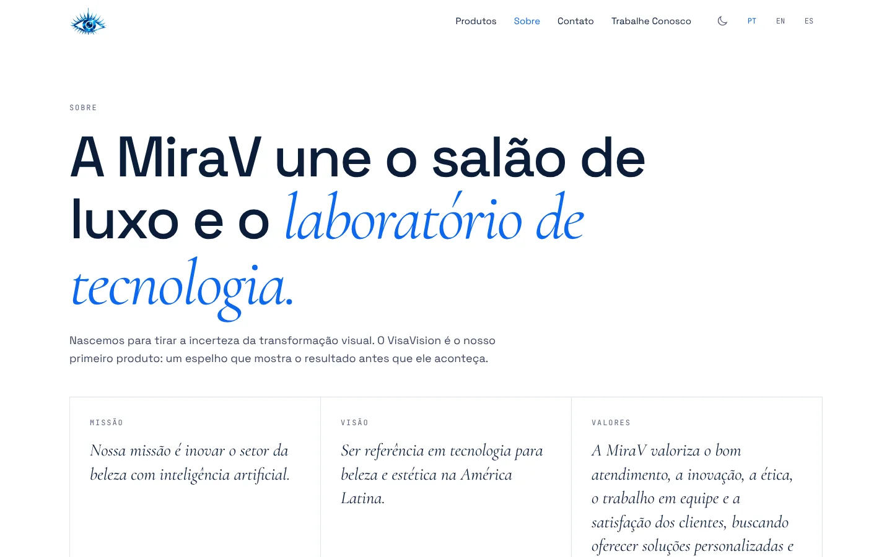
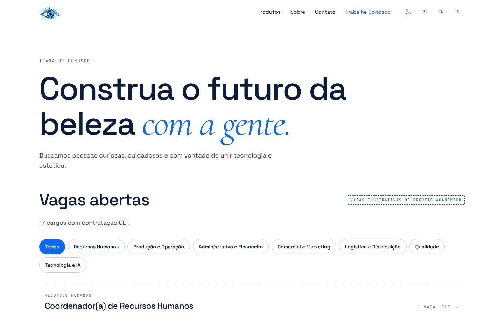
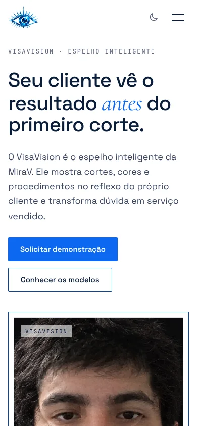

<div align="center">

# MiraV · VisaVision

Site de divulgação do **VisaVision**, o espelho inteligente da MiraV.

*Mais certeza para o cliente, mais resultado para o seu negócio.*

**[Ver o site no ar](https://mirav.aluisioalves6.workers.dev/)**




</div>

## Sobre o projeto

Trabalho de curso em equipe: a turma criou a MiraV, uma startup de beleza e tecnologia, e o VisaVision, um espelho
inteligente que mostra cortes, cores e procedimentos no reflexo do próprio cliente antes do atendimento.
Eu fui o CTO da equipe e desenvolvi o site e a API sozinho.

**O problema:** em salões e barbearias, o cliente fica em dúvida e muitas vezes desiste de um serviço porque não
consegue imaginar o resultado. O site apresenta o produto para donos de salão, explica cada modelo de espelho e
recebe pedidos de demonstração e candidaturas.

**O que dá para ver no site:**

- Espelho interativo na home: troque entre corte, cor, barba e estética e veja a simulação no reflexo.
- O **Miro**, robozinho em pixel art que explica cada seção e conta onde cada espelho fica melhor.
- Cinco formatos de espelho em Produtos, página Sobre com missão, visão e valores, e 17 vagas em Trabalhe Conosco.
- Tema claro e escuro marinho, e o site todo em português, inglês e espanhol.
- Tela `/qr` para o telão da apresentação, com um QR code que leva à home.
- Formulários que vão para uma API própria em Go, com validação, limite de envios por visitante e IP anonimizado.

## Telas

| Home (tema claro) | Home (tema escuro) |
|---|---|
|  |  |
| **Produtos** | **Sobre** |
|  |  |
| **Trabalhe Conosco** | **No celular** |
|  |  |

## O que tem aqui


| Pasta | O que é | Tecnologia |
|---|---|---|
| `web/` | Site: home (com o espelho interativo e o Miro), Produtos, Sobre, Contato, Trabalhe Conosco (com as vagas) e a tela do QR code `/qr` | Next.js 16 (TypeScript, Tailwind 4, three.js), exportado como site estático |
| `api/` | API: recebe os formulários de Contato e Trabalhe Conosco | Go 1.24 (só biblioteca padrão + `lib/pq`) |
| `api/internal/db/migrations/` | Tabela dos formulários | PostgreSQL 16 |


---

## Rodar no computador

Você precisa de **Go 1.24+**, **Node 20+** e **PostgreSQL 16** (ou Docker).

### 1. Banco e API

Com Docker (mais simples):

```bash
cp api/.env.example api/.env
docker compose up --build         # sobe PostgreSQL e API em http://localhost:8080
```

Sem Docker, com um PostgreSQL já instalado:

```bash
cd api
cp .env.example .env              # ajuste DATABASE_URL
export $(grep -v '^#' .env | xargs)
go run ./cmd/server
```

A API cria a tabela sozinha na primeira execução. Teste com:

```bash
curl http://localhost:8080/saude
```

### 2. Site

```bash
cd web
cp .env.example .env.local        # para enviar à API local: NEXT_PUBLIC_API_URL=http://localhost:8080
npm install
npm run dev                       # http://localhost:3000
```

Páginas: `/`, `/produtos/`, `/sobre/`, `/contato/`, `/trabalhe-conosco/` (e uma página para cada vaga).
Fora do menu: `/qr/`, a tela do telão, com um QR code que leva à home.

### 3. Testes

```bash
cd api && go test ./...           # API: formulários, limites de envio, CORS
cd web && npm run lint && npm run build
```

---

**Para receber os formulários de verdade (opcional, depois):**

| Parte | Serviço | Observações |
|---|---|---|
| Banco | **Neon** (plano Free) | 1 GB por projeto, sem cartão e sem prazo. Região AWS US East 1. Use o endereço sem `-pooler`. O banco "dorme" após 5 min parado e acorda sozinho. |
| API | **Render** (Free, Docker) | Use o `render.yaml` (New > Blueprint). O serviço dorme após 15 min sem acesso e leva cerca de 1 min para acordar. Não use o Postgres gratuito do Render, que expira em 30 dias. |

Depois, defina `NEXT_PUBLIC_API_URL` no Cloudflare com o endereço da API e coloque o endereço do site em `ALLOWED_ORIGINS` na API (é o que libera o CORS).

---

## Banco de dados

- `leads`: formulários de Contato e Trabalhe Conosco, com o IP anonimizado por hash.

Para ver os formulários recebidos:

```sql
SELECT tipo, nome, email, tipo_negocio, area, mensagem, criado_em FROM leads ORDER BY criado_em DESC;
```

## API

| Método | Rota | Corpo |
|---|---|---|
| GET | `/saude` | |
| POST | `/v1/contato` | JSON: `nome`, `email`, `telefone?`, `empresa?`, `tipo_negocio?`, `mensagem`, `consentimento`, `idioma` |
| POST | `/v1/candidaturas` | JSON: `nome`, `email`, `telefone?`, `area`, `link?`, `mensagem`, `consentimento`, `idioma` |

Os erros vêm com `erro` (código), `mensagem` (no idioma pedido) e `campos` (o que está inválido). Os formulários aceitam 3 envios seguidos e depois 2 por minuto, por visitante.

## Identidade

Paleta azul da marca, com dois temas: **claro** (padrão) e **escuro marinho**, trocados pelo botão de lua/sol no cabeçalho. Azul principal `#0C67F1`, azul escuro `#0846A4`, ciano `#01A9DB`, marinho `#0A1D39` (texto) e `#00102A` (fundo do tema escuro). As cores ficam em `web/src/app/globals.css`.

Fontes: Space Grotesk (títulos e texto), Cormorant Garamond itálico (destaques), JetBrains Mono (rótulos) e Cinzel (palavra MIRAV).

Logo: no site aparece o **olho da logo azul**. Nas telas de carregamento entra a versão simplificada.

**Miro:** o robozinho em pixel art da MiraV. Na home ele explica o espelho e cada seção; em Produtos, conta onde cada espelho fica melhor.

Os números da home aparecem como estimativas da MiraV, e os casos como exemplos de uso.

Equipe: Luan Sousa (CEO), Aluísio Alves (CTO), Caio (COO), Ryan (CFO) e Livia Felix (CMO). Site desenvolvido por Aluísio Alves.
